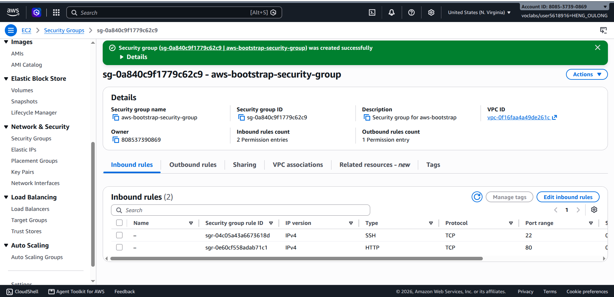
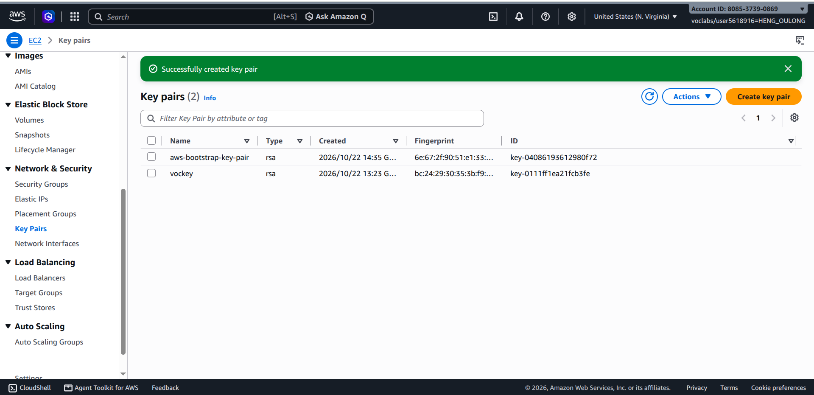
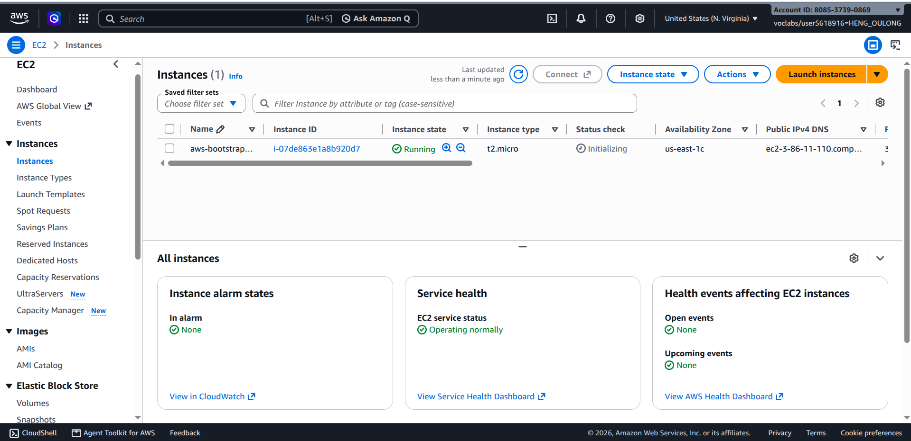
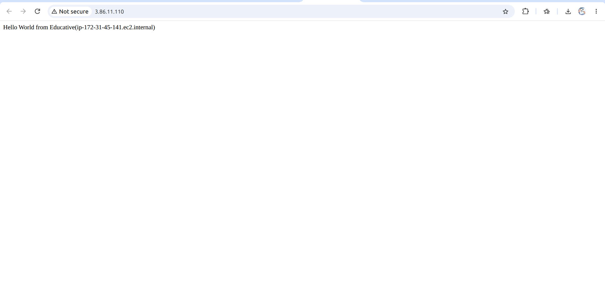
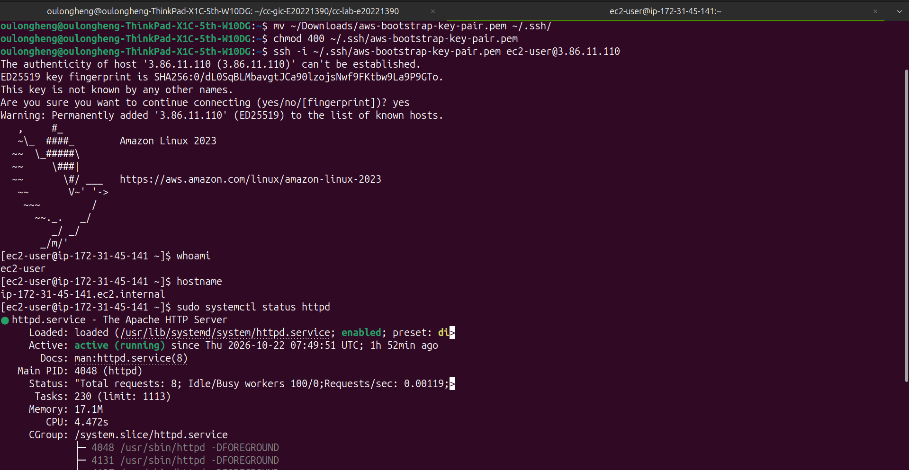
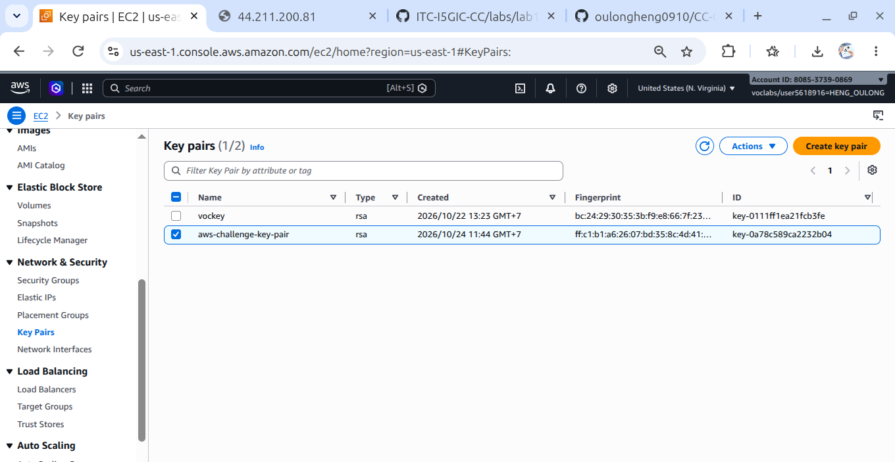
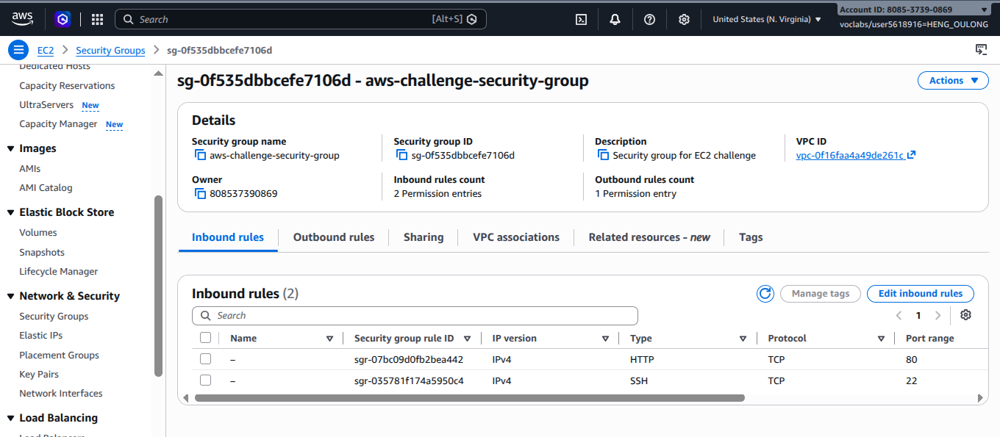
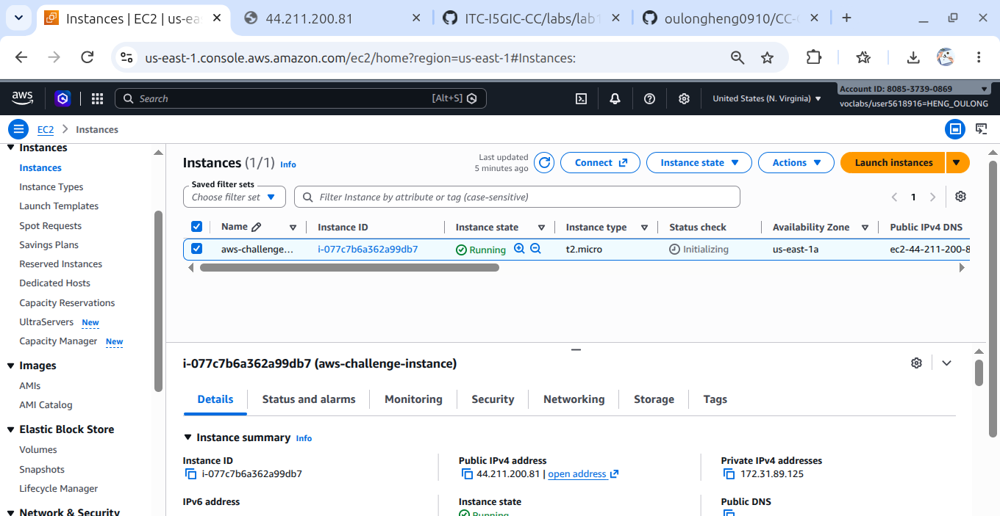
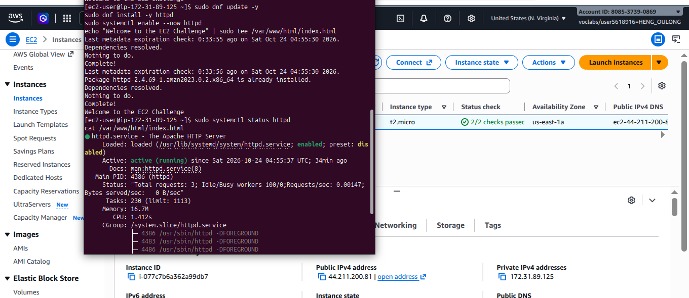
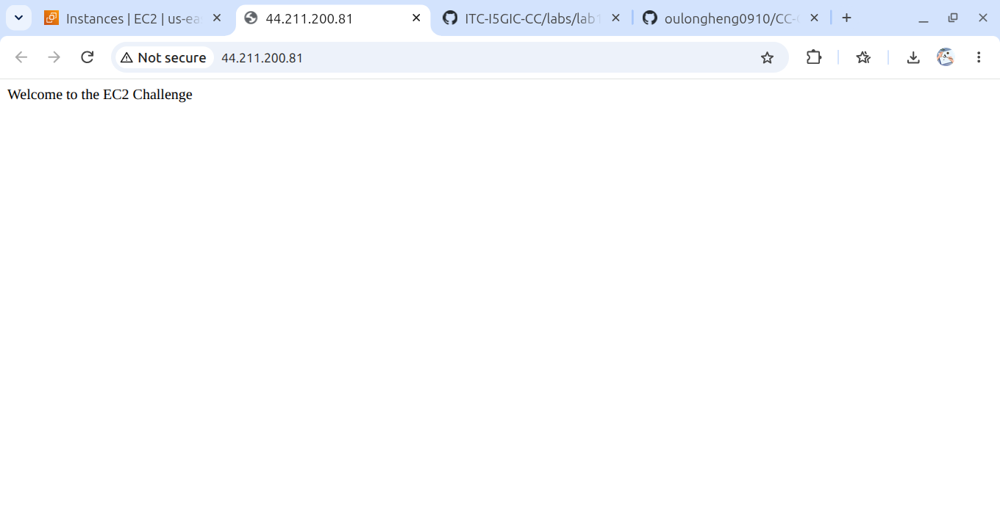

# Cloud Lab 1 Submission — Amazon EC2

- **Student name:** HENG OULONG
- **Student ID:** e20221390
- **Learner Lab user name:** HENG_OULONG
- **Date completed:** 22/10/2026

---

## Part 1.1 — An Amazon EC2 Walkthrough

### Security group



### Key pair



### Instance details



### Browser test



### SSH connection



Did you connect with your own SSH client or with EC2 Instance Connect?

=> with my own ssh client connect.
---

## Part 1.2 — EC2 Web Solution (Challenge)

### Launch configuration



### Security group



### Running instance



### Commands on the instance



Paste the commands you ran to install the web server and create `index.html`:

```bash
sudo dnf update -y
sudo dnf install -y httpd
sudo systemctl enable --now httpd
echo "Welcome to the EC2 Challenge" | sudo tee /var/www/html/index.html
```

### Browser test



---

## Questions

1. Your security group has an SSH rule and an HTTP rule. What does each one let you do? What would stop working if you deleted the HTTP rule?
=> The SSH (port 22) allows me to connect remotely to the EC2 instance and manage the linux server using a terminal. The HTTP (port 80) allows users to access to the web server through a browser using an HTTP url.
=> If I deleted the HTTP rule, external users could not access to the web server through the http.
2. In Part 1.1 you never logged in to install the web server. What installed it, and when did it run?
=> The web server was installed using EC2 user data, a startup script provided when launching hte instance. So the script ran automatically during the instance's initial boot.
3. Why does the web page open with `http://` but not with `https://`?
=> The websites is configured using http traffic on port 80. HTTPS normally on port 443 and requires a suitable TLS/SSL configuration.
4. Part 1.2 asked for a 10 GiB root volume. Where in the launch settings did you set it, and how can you check the size on the running instance?
=> I configured the root volume size in the Configure storage section of the EC2 Launch Instance page by setting the volume size to 10 GiB.
I can verify the size in the AWS Console by opening EC2 → Instances, selecting my instance, and checking the root volume details. I can also open EC2 → Volumes, locate the volume attached as the root device, and check its size. On Linux, I can use lsblk to inspect the disk and partition sizes. The EBS volume size and the filesystem size may differ if the filesystem has not been extended.
