# Cloud Lab 2 Submission — Load Balancer and Auto Scaling


- **Student name: Heng Oulong**
- **Student ID: e20221390**
- **Learner Lab user name: HENG_OULONG**
- **Date completed: 6/11/2026**

---

## Security groups

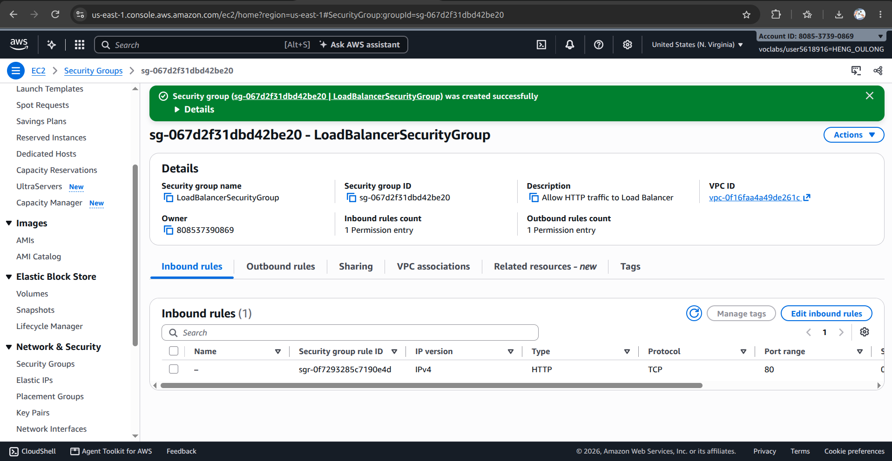

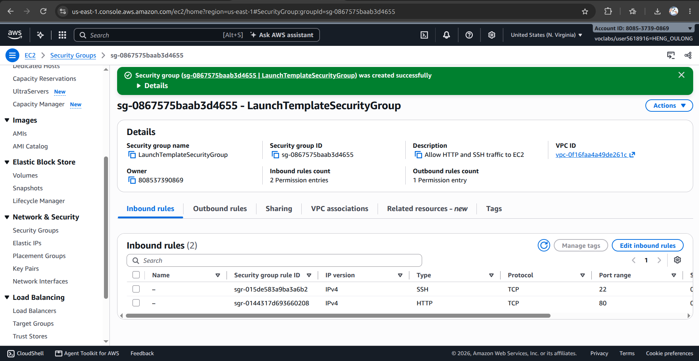

## Target group

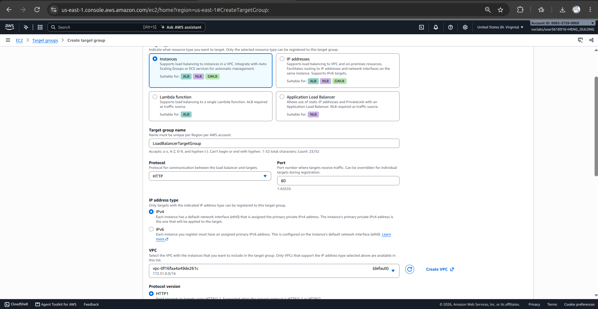

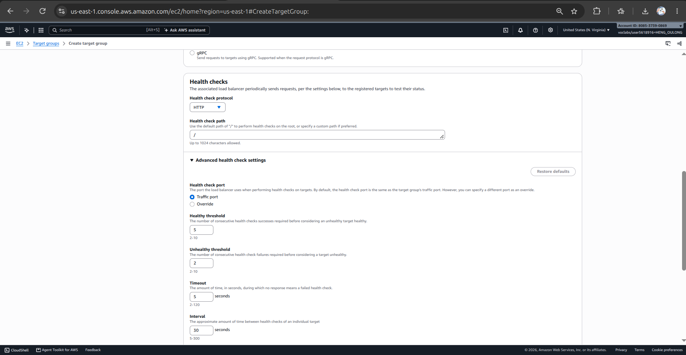

## Application Load Balancer

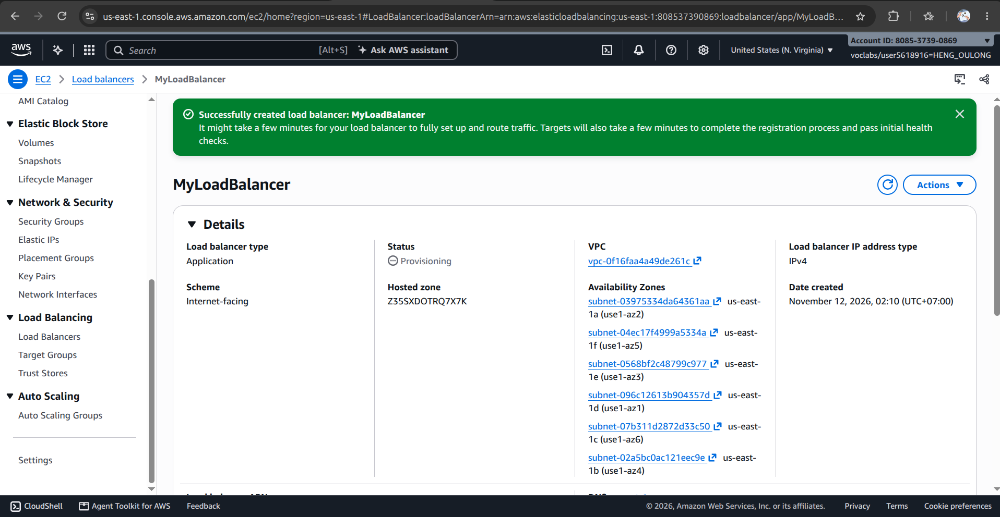

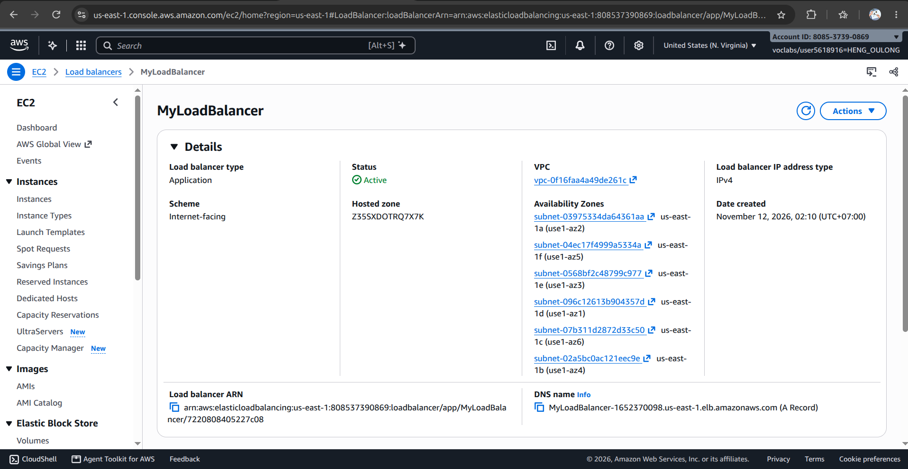

## Launch template

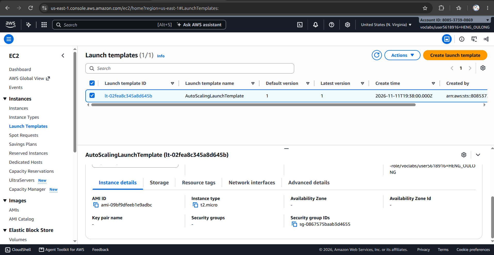

## Auto Scaling group

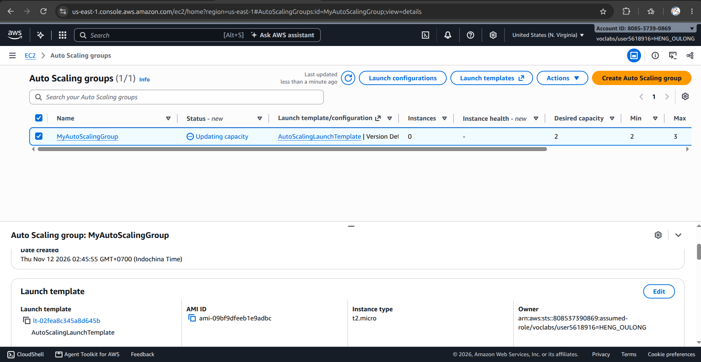

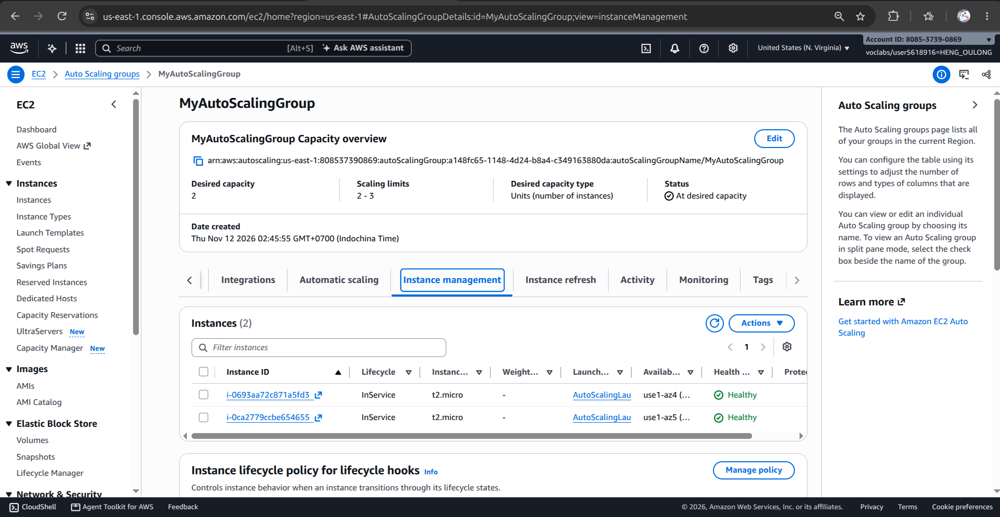

## Load balancing test


## Simulated application failure

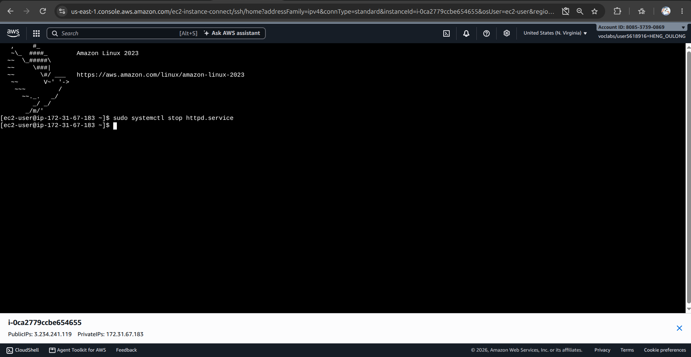

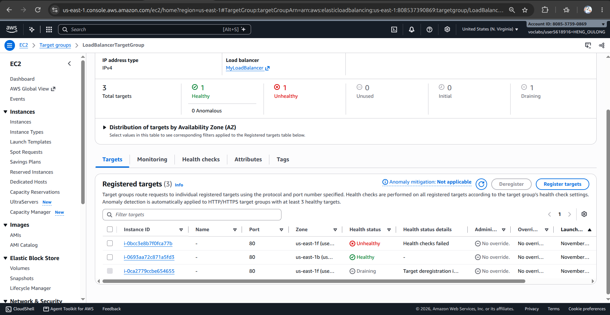

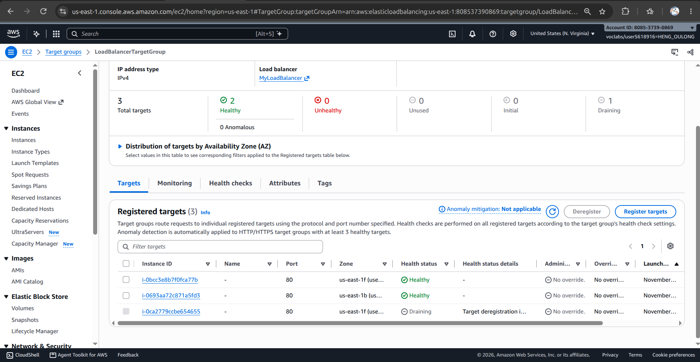

About how many minutes passed between stopping `httpd` and the new instance becoming healthy?

=> it is a few minutes.


## Questions

### 1. Why does the page show a different host name when you refresh it?

The page shows different hostnames because the Application Load Balancer (ALB) distributes incoming HTTP requests across multiple healthy EC2 instances.

Each EC2 instance has its own unique hostname. When a user refreshes the page, the ALB may forward the request to a different healthy instance.

For example:
- First request: Hello World from (ip-10-0-1-123)
- Second request: Hello World from (ip-10-0-2-456)
This demonstrates that multiple EC2 instances are serving the same application through one public ALB DNS address.

### 2. After you stopped `httpd`, the instance was still *running* in EC2, but the target group marked it *unhealthy*. What did the health check test, and why did the instance fail it?

The Target Group health check tested whether the web application was responding successfully to an HTTP request on port 80 using the / path.

When we stopped Apache using:
```sql
sudo systemctl stop httpd.service
```


The EC2 instance continued running, but its web server stopped responding to HTTP requests.

As a result, the health check failed because the instance could not return the expected HTTP 200 response.

This demonstrates the difference between EC2 instance health and application health. An EC2 instance can be running while the application hosted on it is unavailable.

### 3. Who replaced the failed instance: the load balancer, the target group, or the Auto Scaling group? Explain the role of each one.

The Auto Scaling Group (ASG) replaced the failed EC2 instance.

Each component has a different responsibility:
- Application Load Balancer (ALB): Receives incoming requests and distributes them across healthy EC2 instances.
- Target Group: Registers EC2 instances and performs health checks to determine whether they are healthy or unhealthy.
- Auto Scaling Group (ASG): Monitors instance health through its Elastic Load Balancing health-check integration and replaces unhealthy instances to maintain the desired capacity.
In our experiment, the Target Group detected that the Apache web server had stopped responding. The ASG then identified the unhealthy instance, terminated it, and launched a replacement using the Launch Template.

The new instance automatically installed and started Apache through its User Data script.


### 4. With desired 2, minimum 2 and maximum 3, how many instances run normally? In what situation could there be 3?

Normally, two EC2 instances run because the desired capacity is set to 2.

The three settings have different meanings:
- Desired capacity = 2: The target number of EC2 instances.
- Minimum capacity = 2: The Auto Scaling Group should maintain at least two instances.
- Maximum capacity = 3: The Auto Scaling Group can scale up to three instances.
There could be three instances when the Auto Scaling Group scales out because of increased application demand or when a scaling policy triggers an increase in capacity.

For example, if CPU utilization becomes too high, a configured scaling policy could increase the desired capacity from two to three instances.

Note: Maximum capacity does not mean AWS automatically launches three instances. It only defines the upper limit.


### 5. The instances' security group allows HTTP from anywhere. How could you change it so that the instances accept HTTP **only** from the load balancer?

We can improve security by changing the inbound HTTP rule of LaunchTemplateSecurityGroup.

Currently, the rule allows:

Type	Port	Source

HTTP	80	0.0.0.0/0

This allows any IPv4 address to access the EC2 instances directly.

Instead, we should change the source to the Security Group ID of LoadBalancerSecurityGroup.

Type	Port	Source

HTTP	80	LoadBalancerSecurityGroup

The process is:
1. Open EC2 → Security Groups.
2. Select LaunchTemplateSecurityGroup.
3. Open Inbound rules → Edit inbound rules.
4. Find the HTTP rule on port 80.
5. Change its source from Anywhere-IPv4 to Custom.
6. Select LoadBalancerSecurityGroup as the source Security Group.
7. Save the rules.
Now, only resources associated with the Load Balancer Security Group can access the EC2 instances through HTTP.

This is called Security Group referencing.

It improves security by ensuring that users access the application through the ALB instead of bypassing it and connecting directly to the EC2 instances.